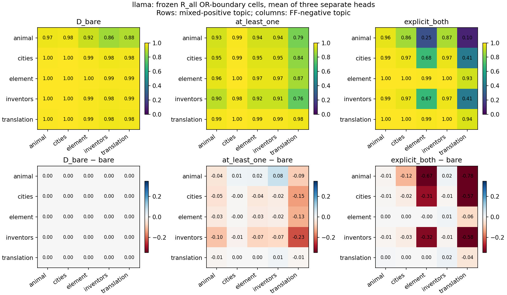
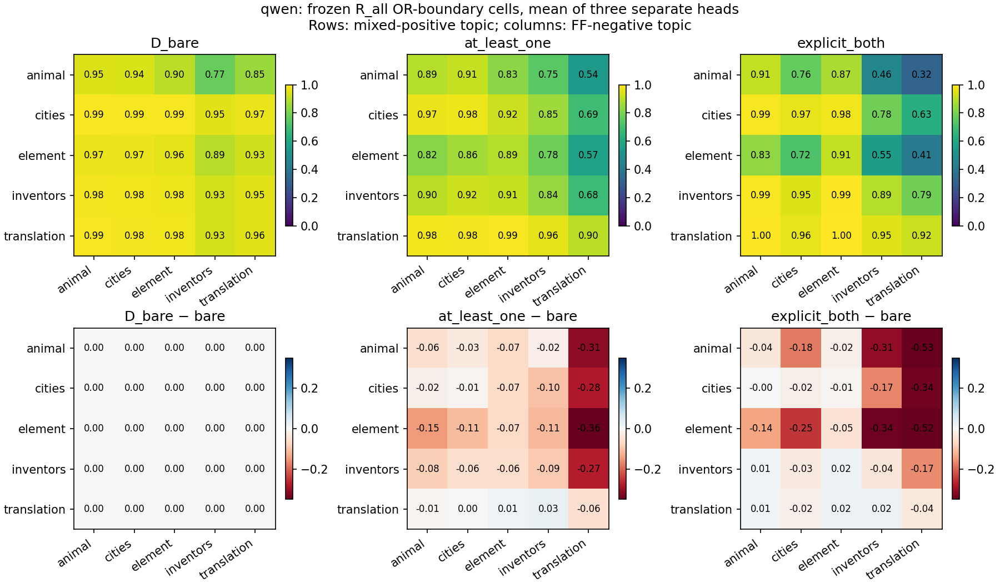
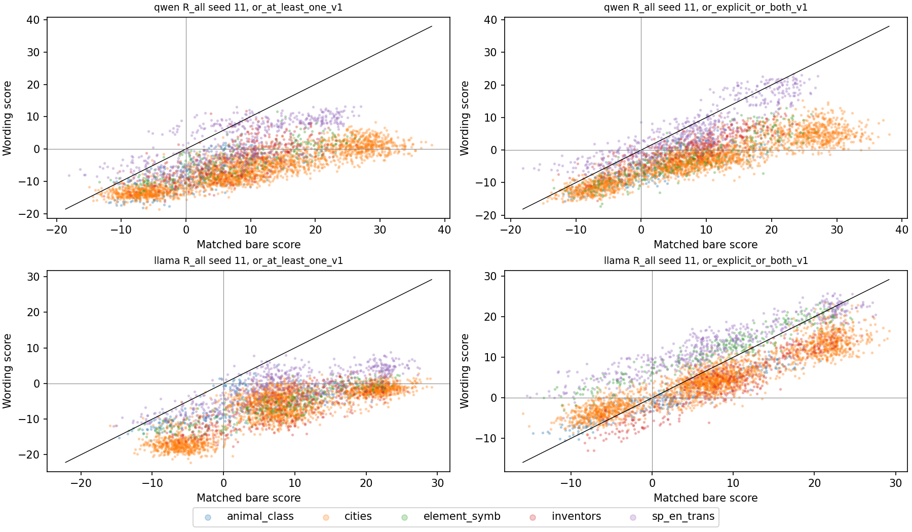
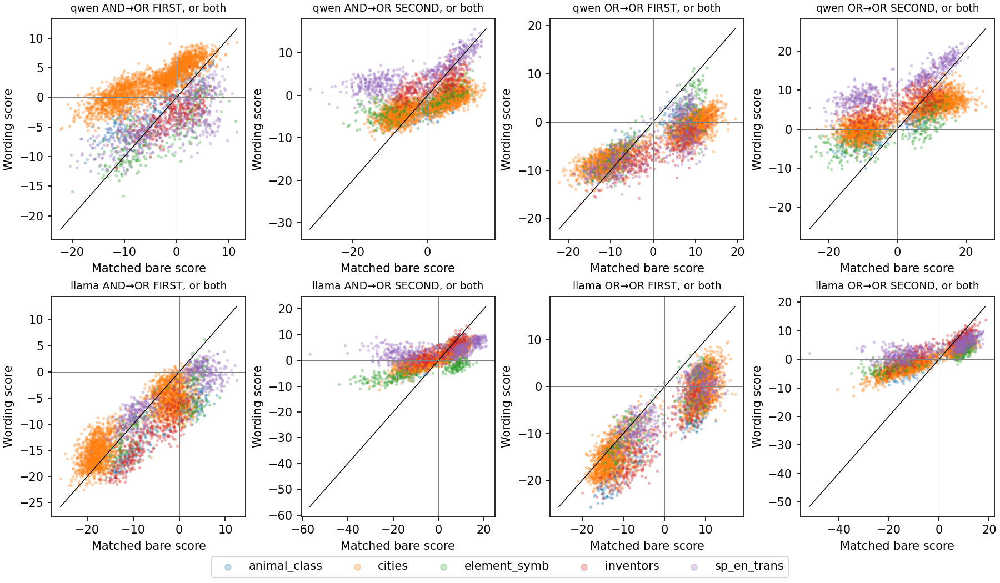

# October 3 Revision 2 saved-score diagnosis and full-training input coverage

**Saved-score diagnosis and metadata-only coverage are complete and independently validated. Residual wording loss combines cross-topic comparability, some within-topic ordering loss, and frozen decision failure; their importance depends on model, head and wording. Full training still needs 131 exact unique texts per model. No new fit or inference was run.**

Producer: `15ecc6aacc70b62a6d275c52ff6011cfd585fd0f`. Exact base: `0a256d96b0fbf41f7ce678693da15cf230685778`, containing completed B25 delivery `1187140c7f79b0b64439eff382d420f51d974a25`. This analysis used only the manifest-resolved B25 producer `5e1bf47a457558cbc0735bd8f9f13ca029cbf3a4` and constituent producer `2d28c0b2733a4433aa6ceb4de020bfb815c2f7db`; no alternate historical package was substituted.

Approved document: October 3 **Revision 2**, `Truth_Probing_Next_Decision_Checkpoint_2026-10-03 (1).docx`, SHA-256 `f81c2209c03eacf5c6fe5e14729d68069035ea3a08de3d2b9eb273b070c4cae2`. The unsuffixed October 3 document is an earlier version. This is not execution of the October 2 Revision 2 plan.

Actual execution: macOS 12.6 arm64 (`Darwin`), hostname `MacBook-Pro-7.local`, Python 3.11.6. Invoked `/private/tmp/clean-extraction-venv/bin/python`, resolved interpreter `/opt/homebrew/opt/python@3.11/bin/python3.11`. One analysis process, followed by one sequential independent audit; OpenBLAS and OpenMP runtime receipts show one thread each. The default shell interpreter inspection also found `/opt/homebrew/bin/python3`, version 3.11.6.

## Global OR-boundary reconstruction

Each cell compares TF/FT positives from topic i to FF negatives from topic j, with half credit for ties. The 25 positive-mass × negative-mass weights sum to one. Matrices and wording-minus-bare changes for **both arms, every sample and all three wordings** are in [boundary-cells.csv](boundary-cells.csv), with a wide matrix view in [boundary-matrices-wide.csv](boundary-matrices-wide.csv). No scores from distinct fitted heads were concatenated. Head identities and layers are in [resolved-panels.json](resolved-panels.json).

The point diagonal mass is **0.42071850794508103**, and off-diagonal mass is **0.5792814920549191**, shared across these heads and wordings. These masses are recomputed in every entity draw. The following are averages of separately calculated sample metrics; the diagonal and off-diagonal contributions add to pooled AUROC. Equal-topic macro is an unweighted five-diagonal mean and is a different quantity.

| Model | Arm | Wording | Pooled | Five-topic macro | Diagonal contribution | Off-diagonal contribution |
|---|---|---|---:|---:|---:|---:|
| Qwen | R_all | Bare | .972621 | .956492 | .413806 | .558815 |
| Qwen | R_all | At least one | .908083 | .898875 | .406988 | .501095 |
| Qwen | R_all | Or both | .882936 | .918102 | .404463 | .478473 |
| Qwen | S_all | Bare | .850301 | .829023 | .387905 | .462395 |
| Qwen | S_all | At least one | .667925 | .653957 | .284114 | .383811 |
| Qwen | S_all | Or both | .714078 | .761033 | .343693 | .370385 |
| Llama | R_all | Bare | .990486 | .986589 | .419461 | .571025 |
| Llama | R_all | At least one | .963032 | .956730 | .416645 | .546388 |
| Llama | R_all | Or both | .888249 | .969190 | .408979 | .479270 |
| Llama | S_all | Bare | .837253 | .814595 | .378447 | .458805 |
| Llama | S_all | At least one | .697126 | .687442 | .294950 | .402177 |
| Llama | S_all | Or both | .734327 | .787329 | .324651 | .409676 |

For Llama R_all, or-both minus bare pooled AUROC is **−.102237 [−.120714, −.081889]**. The diagonal contribution changes by **−.010482 [−.015351, −.006735]**, and off-diagonal contribution by **−.091755 [−.109818, −.072185]**. About 89.7% of the point pooled decline is in off-diagonal comparisons. Within-topic macro still falls **−.017400 [−.030269, −.007088]**; high residual macro performance does not mean zero ordering loss. Or-both topic diagonals range from .9416 to .9935. The conspicuously poor cross-topic cells include animal positives versus translation negatives (.10), animal versus element (.25), and city positives versus translation negatives (.41).

For Qwen R_all, or-both pooled changes by **−.089685**, of which **−.080342** is off-diagonal contribution and **−.009343** diagonal contribution. Macro changes **−.038390**. At-least-one macro drops to .898875, so a solely cross-topic explanation would be incomplete. The complete pointwise intervals, normalized diagonal/off-diagonal AUROCs and sample results are in [boundary-decomposition.csv](boundary-decomposition.csv).

These are descriptions of cross-topic comparisons. Poor off-diagonal cells do not by themselves identify additive offsets or a specific correction. Matched score plots and truth/label/order tables show topic-dependent changes, but no affine transformation or correction was fitted.

### Original repair gains remain a separate finding

The bare R_all-minus-S_all gain reconstructs as **Qwen .122320 [.103754, .138787] pooled and .127469 [.102383, .150424] macro; Llama .153234 [.126578, .178031] pooled and .171994 [.137710, .209818] macro**. Positive diagonal contribution gains are .025901 and .041014. The previously established within-topic repair gains are therefore not explained away by the residual cross-topic wording diagnosis. All original reports remain unchanged.

## Matched wording, ordering and frozen decisions

[matched-deltas.csv](matched-deltas.csv) reports mean, median, population SD, quartiles and range by topic, canonical TT/TF/FT/FF, AB/BA, label, other-constituent truth and exact head. FIRST/SECOND are surface positions, including their swap under BA. [matched-rank-changes.csv](matched-rank-changes.csv) reports within-stratum average tied-rank changes, Spearman, Kendall and sign changes. Exact per-row matches and saved-score deltas are external in `arrays/matched-row-scores.csv`, hash-bound by the delivery manifest.

Conditional deltas alone do **not** establish interference. If wording score equals a × bare score + b with a > 0, deltas can differ across labels and other-truth conditions while ranking stays unchanged. Ordering changes and within-topic AUROC loss provide evidence beyond a single positive affine change. No causal interpretation is established here.

Selected layers remain Qwen AND-source L18 and OR-source L19, and Llama AND-source/OR-source L12, with separate operator-specific trained heads. Both transfer directions and same-source references are retained. [constituent-endpoints.csv](constituent-endpoints.csv) contains all six marginal/conditional AUROCs, decisions, external composition and boundary endpoints at pooled, topic, macro and AB/BA scopes. [constituent-wording-differences.csv](constituent-wording-differences.csv) gives paired uncertainty.

For AND→OR transfer, or-both causes these five-topic macro AUROC changes:

| Model | Endpoint | Bare | Or both | Paired change [95% pointwise interval] |
|---|---|---:|---:|---|
| Qwen | FIRST marginal | .9670 | .8944 | −.07263 [−.09259, −.04978] |
| Qwen | SECOND marginal | .9856 | .8771 | −.10849 [−.12894, −.08389] |
| Qwen | FIRST, SECOND false | .9772 | .9135 | −.06365 [−.09430, −.03412] |
| Qwen | SECOND, FIRST false | .9766 | .8770 | −.09961 [−.13487, −.06472] |
| Llama | FIRST marginal | .9979 | .9815 | −.01641 [−.02350, −.00933] |
| Llama | SECOND marginal | .9958 | .9133 | −.08256 [−.09725, −.06603] |

Qwen thus has identifiable within-topic constituent ordering loss, with pooled marginal AUROCs also falling to .7949/.7855. It cannot be explained by a ranking-preserving positive affine transformation. Llama also has ordering loss in some heads, notably SECOND on AND→OR or-both; a blanket “Llama only has threshold failure” would be wrong. Conversely, Qwen OR→AND under AND wording retains/improves its marginals (.9873→.9861 and .9752→.9985 macro), so wording failure is not uniform across directions.

A clear frozen decision failure appears in **Llama AND-source on AND wording**. FIRST/SECOND macro AUROCs remain **.98824/.99998**, yet Boolean balanced accuracy is **.60777 [.57296, .64489] macro**, and **.563665 [.54377, .58497] pooled**. On 3,864 identical rows, Boolean confusion counts are **TP 123, TN 2,898, FP 0, FN 843**. FIRST has **TP 943, TN 1,929, FP 3, FN 989**; SECOND has **TP 1,927, TN 1,924, FP 8, FN 5**. FIRST changes sign on 998 matched rows while SECOND changes sign on 29. High individual ranking here does not preserve the original zero-logit decision rule.

Other panels mix ordering, decisions and composition. For Llama OR-source on or-both OR, marginal macros remain .9932/.9685 while external max boundary macro is .7804 and Boolean balanced accuracy macro is .7506. High separate-head ranking does not guarantee appropriate cross-head score comparability. [same-support-min-max.csv](same-support-min-max.csv) reports both ranking compositions on the same rows; [frozen-confusion-joint-boolean.csv](frozen-confusion-joint-boolean.csv) contains all per-head confusion, four joint-correctness counts and Boolean decisions by topic/cell/order.

Every decision uses the existing logit ≥ 0 rule, exact ties True. Balanced accuracy is undefined in single-class strata; no thresholds were invented for global AUROC arms. **Positive scaling preserves each individual head's ranking and signs, so it cannot repair its zero-logit decisions. Relative head scales can change min/max ranking.** These observations do not establish that relative scaling alone accounts for the composition losses.

## Uncertainty and independent validation

All existing 2,000 paired entity draws were retained, with exact panel schedule equality and independent regeneration. Wording reuses matched bare endpoint multiplicities. Every draw recalculates positive/negative topic masses. Undefined zero-mass cells contribute zero; zero total positive/negative mass makes pooled AUROC undefined; any missing diagonal makes the fixed five-topic macro undefined. Sample averages use ordinary metric means inside each shared draw, never survivor means.

There are **zero undefined draws in the observed global matrix cells, pooled/macro endpoints or reconstructed constituent all-order endpoints**. Single-class confusion strata retain undefined balanced accuracy separately. Synthetic edge checks explicitly verified tie half-credit, zero class mass, zero topic mass with defined pooled/undefined fixed macro, and the positive-scaling sign/ranking distinction.

All intervals are **95% pointwise percentile, conditional on the frozen heads and support**, not simultaneous matrix/bank guarantees. The cells share rows, heads and entity draws and are dependent. Published per-head and mean pooled/macro values and their bootstrap arrays were reproduced to 1e−12 tolerance. Algebraic reconstruction includes exact pair weights and half ties; the separate calculation's largest floating-point difference is **4.440892098500626e−16**.

Independent audit: **900 sklearn cell point AUROCs; 72,000 pooled and 72,000 fixed-five-topic macro bootstrap values; 1,800,900 cell mass values; 24 published sample-mean points; 1,800 confusion/joint strata; 720 same-support min/max points**. The producer also reproduced every selected constituent point and saved bootstrap endpoint array. See [published-reconstruction.csv](published-reconstruction.csv) and [independent-audit.json](independent-audit.json). This is a separate calculation on the same host, not second-machine replication.

## Full-training coverage and mac 1 queue

The exact **3,040 admitted corrected outer-training bindings** contain all **2,778 P15 bindings**, plus **262 additional bindings**, all verified without changing membership. These 262 are distinct exact texts: **131 affirmative texts reuse compatible accepted TC-isolated fresh representations; 131 negated texts are absent**. The genuinely missing count is therefore **131 unique texts per model, 262 model/input combinations**, not 262 missing texts per model. Similar statements and historical tensors were not used to fill the gaps.

| Topic | Added bindings | Exact compatible reuse | Missing unique texts/model |
|---|---:|---:|---:|
| animal_class | 60 | 30 | 30 |
| cities | 60 | 30 | 30 |
| element_symb | 60 | 30 | 30 |
| inventors | 52 | 26 | 26 |
| sp_en_trans | 30 | 15 | 15 |
| Total | 262 | 131 | 131 |

[missing-input-queue.json](missing-input-queue.json) is the bounded handoff to mac 1, SHA-256 **`069382d42e56109709a4842690c7cb5503031ce15e21b528b0ba497b53e97b6f`**. It preserves the exact missing statements, complete reviewed source bindings, both pinned models, accepted numerical/token/representation contract and membership/document hashes. Missing token IDs are intentionally pending native tokenizer binding; they were not guessed. This task authorizes no extraction. A later mac 1 extraction must record its quota, runtime and transfer checks under a separately reviewed launch contract.

[full-training-coverage.csv](full-training-coverage.csv) records every logical/model binding, compatible reuse identity, token hashes and physical representation location/hash. All **226 accepted fresh activation files, totaling 16,589,889,792 bytes**, were rehashed as opaque bytes, alongside row/token receipts and indexes. **Zero activation tensors were loaded**. No historical tensors or conditional historical reuse entered coverage. The accepted input location came from the committed acceptance, not a guessed fitting path.

The deterministic t_G/TTPD full-training sampler is exactly **1,000 rows: 100 per original dataset, 200 per topic**, using paired affirmative/negated membership and original RandomState(0)/topic order. It matches the reviewed full-training projection exactly. Ordered membership hash: **`c8093cce419a79a3ec1dc6c698391bd0f41b1bda92f4c2675cafeaeb41fb51bc`**. See [full-training-balanced-1000.csv](full-training-balanced-1000.csv), [additional-262-bindings.csv](additional-262-bindings.csv) and [coverage-summary.json](coverage-summary.json).

Future standardized full-training procedures must refit population mean/std and constant-feature handling on the full admitted 3,040 rows. Raw LR retains its existing C scaling; all methods retain their current preprocessing/objective conventions. t_G/TTPD use the recorded 1,000-row sampler rather than reduced-P15's 700 rows. This sensitivity changes exposure, preprocessing and sampling jointly. A15 identities become training-exposed and overlap the selection sample; D remains entity-disjoint. No preprocessing values or full-bank heads were fitted here.

The later report must retain **R_all−S_full; S_full−S_atom_full; R_all−S_atom_full; S_full−original S_all**, plus eligible/unrestricted full/P15 bank references, atomic/AND retention, OR/boundary, wording, every sample, pooled, fixed-topic macro and per-topic results. Eligibility keeps the original reduced-LR atomic D reference minus .005. These remain reporting requirements, not launch authorization. Missing inputs block a complete full-bank run until independently accepted.

## Execution, preservation and stopping status

Analysis runtime was **111.06 s**, including **22.64 s** in coverage/opaque fresh hash verification; Darwin peak RSS **1,364,082,688 bytes (1.27 GiB)**. Sequential independent audit runtime was **49.24 s**, peak RSS **1,513,275,392 bytes (1.41 GiB)**. Runtime receipts are monotonic function durations; interpreter startup is not included. Memory is process maximum RSS, not a system-wide peak. System process listing was denied by the sandbox, so no system-wide measurement is claimed.

There were no scientific analysis/audit failures, mismatches, missing saved-score panels or numerical cap hits. One initial CLI launch mistakenly supplied an abbreviated producer SHA; the full-SHA guard stopped before creating outputs or computing analysis. The corrected full-SHA launch completed once. Matplotlib used a temporary cache because its default directory was not writable; plots completed. An initial packaging preservation guard stopped when the concurrent `checkpoint-next-behavior-prep-20261003` worktree acquired additional untracked files; its head was unchanged at that observation. This worktree was not written by this task. The before/after snapshots record external changes explicitly instead of claiming every worktree's status stayed fixed. These events are preserved in [execution-accounting.json](execution-accounting.json). The only input gap is the 131 missing raw texts/model listed above.

Origin was fetched before creating the isolated branch from the exact requested SHA. No pull, merge, SSH/GPU, probe fitting, calibration, new fact generation, label/membership mutation, behavior/chat or E predictions occurred. New outputs occupy a fresh external directory; approximately 101 MiB of bootstrap arrays and row score tables remain outside Git. Original source files were hash-bound and unchanged by size/mtime/ctime during execution. Post-delivery preservation checks compare all 15 pre-existing worktree heads/statuses, reporting the concurrent behavior-preparation worktree's changed status separately. The 15 unrelated untracked files (the original 13 plus the two document copies) retain their exact hashes. All existing files in this successor match the exact base; the branch adds files only.

Only `checkpoint-next-score-diagnosis-20261003` is to be pushed. No merge into `clean-eval-protocol`. This bounded task stops here. Full-bank sensitivity, behavior/chat, any objective ablation and the later scientific decision remain deferred. Reproduction instructions and exact contracts are in [the frozen task documentation](../../docs/checkpoint_r2/next_score_diagnosis_20261003.md).
